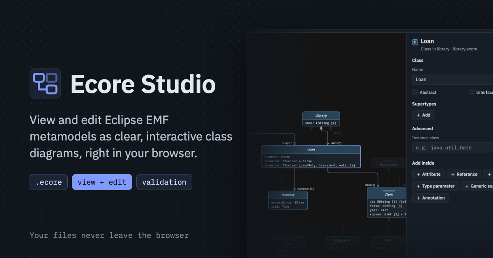

# Ecore Studio

View and edit Eclipse EMF metamodels as clear, interactive class diagrams, right in your browser.

**[Open Ecore Studio →](https://gcoulby.github.io/model-viewer/)**



Drop in one or more `.ecore` files and you get a UML-style class diagram: classes, interfaces, enums, data types, references and inheritance. References between files are joined up. There's nothing to install and no Eclipse needed. Files are read in the browser and never uploaded anywhere. Your open files are kept in the browser's own storage, so they're still there when you come back. Close a file to remove it.

There are three modes. **View** is for exploring a model. **Edit** (**E**) is for changing the metamodel. **Instance** (**I**) is for making instances of it.

## Editing

Edit mode works like Eclipse's Ecore editor, laid out like the rest of the app:

- **The tree shows everything a file holds**: packages, classes, enums and data types, and inside them attributes, references, operations, parameters, literals, annotations, type parameters and generic types. Right-click a row for **New child**, **New sibling**, **Duplicate**, **Move up/down** and **Delete**, or use the **+** on a row. Drag rows to reorder them or to move them somewhere else in the same file.
- **The Properties panel edits whatever is selected**, in the tree or on the diagram. Click a box to edit the class, or a line to edit its reference. A class lists all of its attributes, references and operations, including those the diagram draws as lines, plus what it inherits. Click one to edit it, or click its type to go there. Types are picked from every open file and Ecore's own types. Setting a reference's opposite pairs both sides.
- **Renames and moves carry references with them**, across every open file. Deleting a class takes it out of supertype lists and opposites.
- **The diagram stays put while you work.** New boxes appear beside their package and **Re-layout** tidies up when you ask. Back in view mode, the diagram is laid out afresh.
- **Problems are checked as you go**, using the rules of Eclipse's Ecore validator: missing or wrong types, references to things that no longer exist, invalid or clashing names, opposites that don't agree, supertype cycles, impossible bounds, missing namespaces. The Problems button in the top bar lists them, and clicking one takes you to it. Rows with a problem are marked in the tree, and the Properties panel shows what's wrong. Saving still works with problems, but tells you about them.
- **Behaviour flags show on the diagram** as UML modifiers, such as `{readOnly, transient}`, alongside `/` for derived features and `{id}`. Only flags that differ from the default are shown.
- **Undo and redo** every change (⌘Z / ⇧⌘Z). Other shortcuts: **Enter** renames, **Del** deletes, **Alt ↑/↓** moves, **⌘D** duplicates.
- **Save** (⌘S) downloads the files you've changed, or a zip if there are several. Anything you didn't touch is written back exactly as it was, annotations and all.

## What it does

- **Opens your models however they come.** Open files, open a whole folder, drop files or a `.zip` onto the canvas, or paste XML. It accepts `.ecore`, `.xmi`, `.xml` and `.emf` files. Loading a file with the same name replaces the old one.
- **Lays out big models readably.** Pick from seven layouts:

  | Layout | Good for |
  | --- | --- |
  | Layered | The default. Rows of boxes with few crossings and links routed around boxes. |
  | Layered (classic) | A quicker, simpler layered layout. |
  | Tree | A tidy inheritance tree, one parent per box. |
  | Stress | Reference-heavy models; linked boxes sit close together. |
  | Force | An organic layout where links pull and boxes push apart. |
  | Radial | Rings around a root box. |
  | Packed grid | A compact index of everything, ignoring links. |

  You can also choose which links shape the layout (all, inheritance and containment, or inheritance only), the direction, the spacing, and whether boxes are framed by file or by package.
- **Lists every feature in its box.** Attributes and references each get their own section, so a class shows everything it holds even when a reference is also drawn as a link. Untick **Reference rows** to draw references only as links, UML style.
- **Draws links your way.** Lines can be routed, square, curved or straight. With square lines all subtypes of a class share one line to it. Links that don't shape the layout can be hidden until you select a box, which keeps large diagrams clean.
- **Helps you find your way.** Search the model tree, click any type to centre it, and see its details: supertypes, subtypes, attributes, references, operations, inherited features, and where an enum or data type is used. Show only one file, or hide packages you don't need.
- **Exports what you see.** Export the whole diagram as SVG or PNG, in the current theme.
- **Light and dark themes.** It follows your system setting until you pick one.

## Instances

Instance mode is the counterpart to Eclipse's **Create Dynamic Instance** and reflective editor: it builds models from your metamodel's classes.

- **New instance** starts a file from a class. The classes nothing else contains come first, since they're the usual roots. Opening an existing `.xmi` file finds its metamodel by namespace URI.
- **The tree shows the objects.** Right-click one for **New child**, which offers only the classes its containment references accept, subclasses included. Duplicate, move, delete and drag work as they do in edit mode. The **+** on a file adds another root object to it, for objects nothing in the file contains; a file with several roots is saved inside `xmi:XMI`, as EMF writes it.
- **The Properties panel shows every feature of the object's class.** Each attribute gets a field that fits its type: text, numbers, a checkbox, a list of enum literals or a date picker. References pick from objects of a fitting type, and the **+** beside one makes a new object for it, wherever it fits in the file. Containment references list what they hold. Derived features, and references to the object's container, are shown but not edited.
- **The diagram shows the objects**, UML style, as `name : Class` with their values, linked by containment and references.
- **Problems are checked as you go**: required values left empty, too many values, values that don't fit their type, references to missing or wrong-typed objects, duplicate IDs, and classes that aren't in the metamodel.
- **Instances save as EMF XMI**, so Eclipse opens them. References between objects are written as paths such as `//@items.0` (`/0/@items.0` with several roots), and kept right when objects are moved or deleted. For now an instance lives in one file.

## Constraints

Constraints add rules a metamodel's multiplicities can't express: a range for a number or date, how many values a list needs, the values allowed, or a pattern a string must match. Set them in the **Constraints** section of an attribute or reference in Edit mode, or review them all with the **Constraints** button in Edit and Instance modes.

- They're saved in the `.ecore` as an annotation on the feature (`source="http://ecore-studio/constraints"`), so they travel with the file. Eclipse ignores annotations it doesn't know.
- Problems checks instances against them, and the metamodel's Problems reports a constraint that doesn't make sense, such as a minimum above its maximum or a broken pattern.
- **Generate instance…** follows them.

## Generating instances

**New instance ▸ Generate instance…** makes a filled-in instance file instead of an empty one: pick a root class, a size and whether optional features are filled too. It creates contained objects, values that fit their types and constraints, and references, making an object when a required reference has nothing to point at. The same seed always gives the same model.

## Analysis

Analysis mode (**A**) measures the open metamodels: counts, inheritance depth, features per class, containment roots and depth, and a sortable table of every class with its coupling (fan-in and fan-out) and subclasses. Its findings flag classes that can't be instantiated (required containment that never ends), classes no root can contain, abstract classes with no subclasses, unused enums and data types, isolated, empty, large or deeply inherited classes, naming, and validation problems. Click any class to open it in Edit mode. **Report** downloads it all as an HTML page or Markdown.

## Running it locally

You need [Node.js](https://nodejs.org/) 24 and [pnpm](https://pnpm.io/).

```sh
pnpm install
pnpm dev
```

Then open the address it prints. There are three samples under **Samples** if you want something to look at straight away.

| Command | What it does |
| --- | --- |
| `pnpm dev` | Starts the dev server with hot reload. |
| `pnpm build` | Type-checks and builds the site into `dist/`. |
| `pnpm preview` | Serves the built site. |
| `pnpm lint` | Runs oxlint. |
| `pnpm exec vitest run` | Runs the tests for the parser, graph, layout and routing. |

## How it's built

Vite, React and TypeScript, with Tailwind and shadcn/ui for the interface. The diagram is drawn with [React Flow](https://reactflow.dev/). Layouts come from [ELK](https://eclipse.dev/elk/) (via `elkjs`, run in a web worker) and [dagre](https://github.com/dagrejs/dagre). The parsing, graph building, layout and routing code is plain TypeScript in `src/lib/ecore/`, with no React in it.

## Deployment

Every push to `main` builds the site and publishes it to GitHub Pages, using `.github/workflows/deploy.yml`. The base path comes from the workflow, so the app works from the repository's sub-path.

Link previews (Open Graph and Twitter cards) need the site's full address. It defaults to `https://gcoulby.github.io`. If the site moves to a custom domain, set `SITE_ORIGIN` when building.
