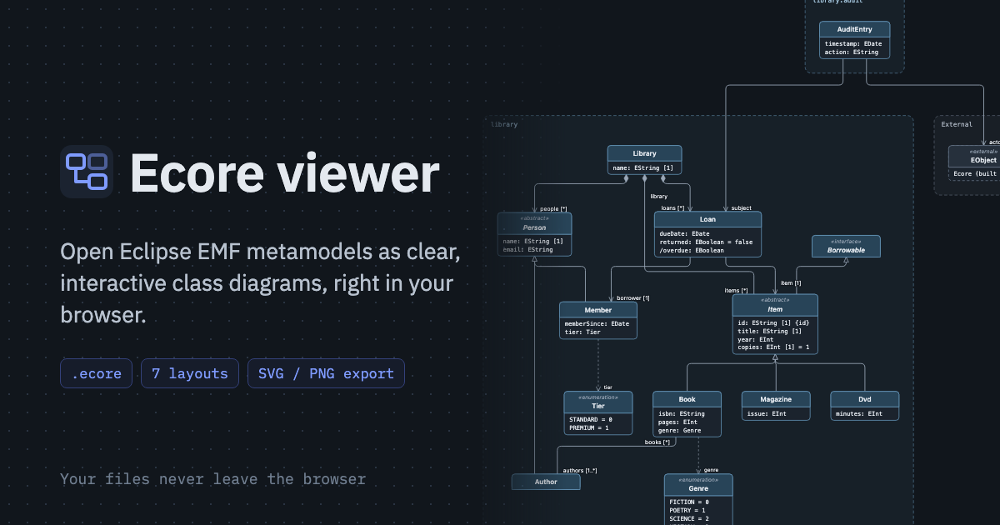

# Ecore viewer

Open Eclipse EMF metamodels as clear, interactive class diagrams, right in your browser.

**[Open the viewer →](https://gcoulby.github.io/model-viewer/)**



Drop in one or more `.ecore` files and you get a UML-style class diagram: classes, interfaces, enums, data types, references and inheritance. References between files are joined up. There's nothing to install and no Eclipse needed. Files are read in the browser and never uploaded anywhere.

It's a viewer, not an editor. It doesn't change, validate or save your models.

## What it does

- **Opens your models however they come.** Open files, open a whole folder, drop files or a `.zip` onto the canvas, or paste XML. It accepts `.ecore`, `.xmi`, `.xml` and `.emf` files. Loading a file with the same name replaces the old one.
- **Lays out big models readably.** Pick from seven layouts:

  | Layout | Good for |
  | --- | --- |
  | Layered | The default. Rows of boxes with few crossings and links routed around boxes. |
  | Layered (classic) | A quicker, simpler layered layout. |
  | Tree | A tidy inheritance tree, one parent per box. |
  | Stress | Reference-heavy models; linked boxes sit close together. |
  | Force | An organic layout where links pull and boxes push apart. |
  | Radial | Rings around a root box. |
  | Packed grid | A compact index of everything, ignoring links. |

  You can also choose which links shape the layout (all, inheritance and containment, or inheritance only), the direction, the spacing, and whether boxes are framed by file or by package.
- **Draws links your way.** Lines can be routed, square, curved or straight. With square lines all subtypes of a class share one line to it. Links that don't shape the layout can be hidden until you select a box, which keeps large diagrams clean.
- **Helps you find your way.** Search the model tree, click any type to centre it, and see its details: supertypes, subtypes, attributes, references, operations, inherited features, and where an enum or data type is used. Show only one file, or hide packages you don't need.
- **Exports what you see.** Export the whole diagram as SVG or PNG, in the current theme.
- **Light and dark themes.** It follows your system setting until you pick one.

## Running it locally

You need [Node.js](https://nodejs.org/) 24 and [pnpm](https://pnpm.io/).

```sh
pnpm install
pnpm dev
```

Then open the address it prints. There are three samples under **Samples** if you want something to look at straight away.

| Command | What it does |
| --- | --- |
| `pnpm dev` | Starts the dev server with hot reload. |
| `pnpm build` | Type-checks and builds the site into `dist/`. |
| `pnpm preview` | Serves the built site. |
| `pnpm lint` | Runs oxlint. |
| `pnpm exec vitest run` | Runs the tests for the parser, graph, layout and routing. |

## How it's built

Vite, React and TypeScript, with Tailwind and shadcn/ui for the interface. The diagram is drawn with [React Flow](https://reactflow.dev/). Layouts come from [ELK](https://eclipse.dev/elk/) (via `elkjs`, run in a web worker) and [dagre](https://github.com/dagrejs/dagre). The parsing, graph building, layout and routing code is plain TypeScript in `src/lib/ecore/`, with no React in it.

## Deployment

Every push to `main` builds the site and publishes it to GitHub Pages, using `.github/workflows/deploy.yml`. The base path comes from the workflow, so the app works from the repository's sub-path.

Link previews (Open Graph and Twitter cards) need the site's full address. It defaults to `https://gcoulby.github.io`. If the site moves to a custom domain, set `SITE_ORIGIN` when building.
